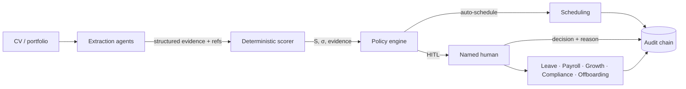
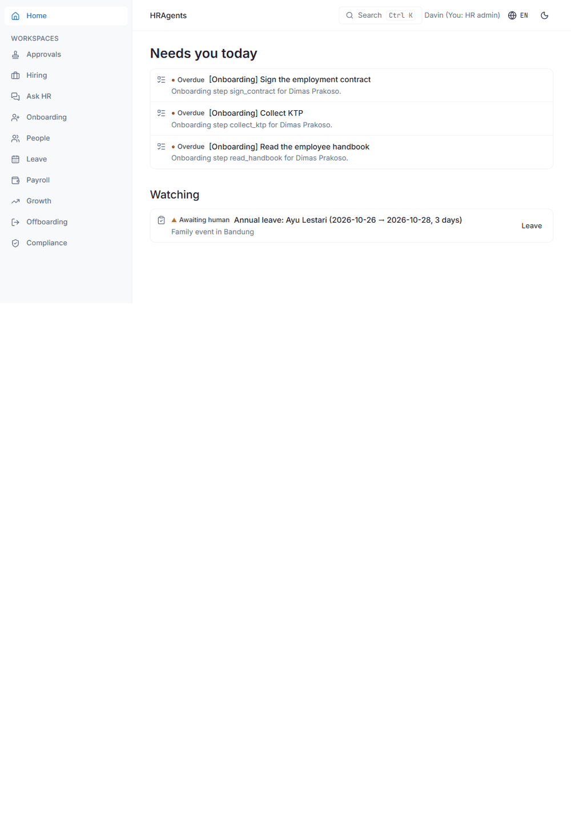

# HRAgents — A Virtual HR Team for the HR Department of One

> One HR generalist, ten jobs, no time. HRAgents gives them a team: agents that read,
> chase, calculate, and draft — while humans keep every decision that matters.

**Free and open source (Apache-2.0).** Self-host it, inspect it, modify it. The author
offers paid integration services for companies that want it running without the
technical work — see [Work with the author](#work-with-the-author).

[](https://github.com/davinakmalyasha/HRAgents/actions/workflows/ci.yml)
[](https://davinakmalyasha.github.io/HRAgents/)
[](https://github.com/davinakmalyasha/HRAgents/actions/workflows/codeql.yml)
[](LICENSE)

**Status:** desktop free edition — an HR-only cockpit (Tauri 2.12, Rust backend,
encrypted SQLite, no accounts, no telemetry, no paid services). Install the
per-user Windows installer, run the first-run wizard, file the recovery key,
and work offline. The Python server product was deleted at the Gate 5 cut
(corpus frozen, see below); its docs remain under `docs/archive/python-server/`.
Open work is tracked honestly in
[implementation status](docs/plan/desktop-migration/13-implementation-status.md).

---

## Quickstart

One Windows laptop, no cloud keys, no admin rights. Full guide:
[docs/quickstart.md](docs/quickstart.md).

1. Run the per-user installer (`HRAgents_0.1.0_x64-setup.exe`).
2. First-run wizard: company name, HR operator, password.
3. Print the recovery key (Settings → recovery) and file it on paper.
4. Make the first backup (Settings → backup) and store the `.hrbackup` off-machine.

Extraction works offline. For a hosted model (DeepSeek V4.1 Flash via OpenCode Go
— the only live model), put the key in the shell environment:

```bash
export OPENCODE_API_KEY='paste-key-here'
```

The desktop app never reads `.env` files; `set -a; source .env; set +a` loads
the repo file for the session instead.

---

## How the pieces fit



The reasoning behind this split, and the exact automation bounds, are in
[`docs/archive/python-server/architecture/`](docs/archive/python-server/architecture/) and the rendered
[docs site](https://davinakmalyasha.github.io/HRAgents/).

## A look inside



Four screens from the demo dataset — the attention-first home, the shared
approvals queue, people and records, and the operations page with every
provider's state. More in the
[docs site](https://davinakmalyasha.github.io/HRAgents/latest/).

## Why this exists

Indonesian SMEs run hiring and HR on one overloaded person, WhatsApp, and spreadsheets.
The failure is structural, and it is documented:

- **Measured**: recruiters make initial résumé fit decisions in ~7.4 seconds (Ladders
  eye-tracking study), and hiring discrimination has remained essentially unchanged for
  decades (Quillian et al., PNAS 2017; Bertrand & Mullainathan, AER 2004).
- **Documented**: Amazon's ML recruiting engine learned gender bias from 10 years of
  résumés and was disbanded (Reuters, 2018). Accelerating bad judgment scales the failure.
- **Regulated**: recruiting AI is classified high-risk (EU AI Act, Annex III(4)(a));
  solely automated consequential decisions are restricted (GDPR Art. 22); candidate and
  employee data are protected personal data in Indonesia (UU PDP No. 27/2022).

The fix is not "let AI decide." The fix is **agents extract evidence, deterministic code
scores it, and humans gate every consequential decision** — with a tamper-evident record
of everything.

## What it does

> **Extract → Score → Gate → Communicate**

A submitted application is published to a queue; a worker claims it and runs the
full pipeline. Every step is auditable.

1. **Extract** — LLM agents (PydanticAI) turn résumés, repositories, and documents into
   structured, provenance-tagged JSON. The LLM never judges a person; it structures facts.
2. **Score** — a hand-specified, deterministic function computes the tensor score
   `S ∈ [0,1]^4`: technical depth, stack alignment, systems literacy, verifiable
   certifications. Same input, same score, every time — fully inspectable.
3. **Gate** — auto-scheduling only for high-confidence positive outcomes
   (`S_tech ≥ 0.75`, `σ ≤ 0.05`). Every rejection above the merit floor needs a named
   human signature. Anomalies always route to humans.
4. **Communicate** — async candidate screening (WhatsApp / Telegram / email) collects
   availability and missing information, with response SLAs so no candidate is ghosted.

Every step lands on a hash-chained audit log. Every score cites its evidence.

> **Known limits, stated plainly.** The eight family rubrics (engineering, finance,
> education, healthcare, legal, operations, sales, general) carry per-family evidence
> vocabularies, but per-family calibration numbers are still thin — the pinned
> regression vector is engineering. The knowledge corpus behind "Ask HR" is a seed
> set, not an Indonesian HR library. Live-model fairness and cost-per-application
> are unproven: CI exercises the harness with the deterministic offline model.
> See [remaining work](docs/archive/python-server/plan/remaining-work.md) for the full picture.

### Core formulas (locked)

**Queue priority** — merit balanced against waiting time and risk:

```
P(c) = α·S̄(c) + β·e^(−λ·Δt) + γ·A(c) − δ·R(c)
```

`S̄` weighted score mean · `Δt` hours since submission · `A` availability completeness ·
`R` risk flags. Defaults: `α=0.55, β=0.25, γ=0.10, δ=0.10, λ=0.05/h`; ties broken by
earliest submission.

**Automation gates** — auto-schedule iff `S_tech ≥ 0.75 ∧ σ ≤ 0.05`; mandatory human
review for `S_tech ≥ 0.60` rejections.

## The plan: one HR person, nine departments

| Workspace | Wave | Agents do | Humans gate |
|---|---|---|---|
| **Hiring** | 1 (shipped) | Extract, score, coordinate, draft | Every rejection, every offer |
| **Ask HR** (front door) | 1 | Intent routing, cited policy Q&A | Anything consequential |
| **Compliance** | 1-2 | Consent registry, retention, erasure, breach workflow | Identity verification, every erasure, every purge |
| **Onboarding** | 1-2 | Checklists, document chasing | Contracts, signatures |
| **People** | 2 | Records, expiry alerts, retention | Corrections, sensitive fields |
| **Leave** | 2 | Balance math, policy Q&A, routing | Every approval |
| **Payroll** | 3 | Assemble, calculate, flag, export | **Everything - no payment is ever executed** |
| **Growth** | 3 | Reminders, collection, draft summaries | Every review outcome |
| **Offboarding** | 3 | Checklists, scheduling, tracking | Final pay, anything legal |

Approvals is the tenth workspace: one queue over every department, so a decision
does not hide inside the surface that raised it.

Details: [product concept](docs/plan/product-concept.md) · [HR domain guide](docs/plan/hr-domain-guide.md).

## Repository layout

```
docs/
  plan/            master build plan, desktop migration track, status evidence
  archive/         Python-server docs (history only; the code is deleted)
  adr/             architecture decisions for the desktop edition
parity/
  FROZEN.md        frozen parity corpus + SHA-256 hashes (oracle reference)
  fixtures/        canonical JSON the Rust parity tests consume
rust/
  crates/          hragents-core, store, ipc, agents, cli
  apps/desktop/    Tauri 2.12 shell + React UI
web/               dashboard SPA (separate product track; not the desktop UI)
landing/           public site (Next.js static export; deployed separately)
```

The Python server (`src/`, `tests/`, `migrations/`, `scripts/`) was deleted at
the Gate 5 cut; the frozen fixtures above are its only remains.

## Documentation

The rendered site — with a searchable architecture, deployment guide and API
reference — is at **<https://davinakmalyasha.github.io/HRAgents/>**. The same
sources live here:

- [Master build plan](docs/plan/master-build-plan.md) — the full checklist: phases, departments, progress
- [Remaining work](docs/archive/python-server/plan/remaining-work.md) — the honest backlog: live-model evals, vendor connectors, and deliberate deferrals
- [Release process](docs/archive/python-server/plan/release-process.md) — versioning, branching, how releases are cut
- [Architecture decisions (ADRs)](docs/adr/README.md) — the reasoning behind the locked choices
- [Problem statement](docs/plan/problem-statement.md) — the systemic problem this exists to solve
- [Product concept](docs/plan/product-concept.md) — value, workspaces, dashboard UX, design system
- [HR domain guide](docs/plan/hr-domain-guide.md) — how HR actually works, Indonesian specifics, glossary
- [Literature review](docs/research/literature-review.md) — evidence base and design principles
- [System architecture](docs/archive/python-server/architecture/system-architecture.md) — pipeline, HITL flows, Mermaid diagrams
- [Paper](docs/archive/python-server/paper.md) — design, measured behaviour and honest limitations
- [Deployment & operations](docs/archive/python-server/deployment.md) — self-host with Docker Compose, backups, runbooks
- [MCP server](docs/archive/python-server/mcp-server.md) — `hragents-mcp` for Claude Desktop and IDE agents, read-only by default
- [MCP connector catalog](docs/archive/python-server/mcp-catalog.md) — ATS, HRIS, Slack and calendar templates with data-flow notes
- [HITL bounds](docs/archive/python-server/architecture/hitl-bounds.md) — exact automation boundaries and anti-goals
- [Benchmarks](docs/archive/python-server/architecture/benchmarks.md) — measured performance

## Roadmap

- [x] Deterministic core: extraction, scoring, policy gate, audit chain
- [x] Desktop free edition: Tauri shell, encrypted SQLite, hiring/people/leave/
  payroll-prep/compliance/growth/offboarding, agent helpers, Ask with citations
- [x] Gate 5 cut: Python server source deleted, parity corpus frozen
  (`parity/FROZEN.md`), live-model proof on DeepSeek V4.1 Flash only
- [ ] NSIS rebuild per release, clean-machine verification
- [ ] Human pilot with a real company and a named reviewer
- [ ] Paid distribution track (optional): signing, notarization, auto-update

## Technology

**Desktop app** Rust workspace (5 crates + Tauri 2.12 shell) · SQLite with
SQLCipher encryption, per-install DPAPI-wrapped key · local-first, no accounts,
no telemetry, no paid services.

**Storage:** one encrypted SQLite database per company, integer-sen money, SHA-256
append-only audit chain. Documents encrypted with ChaCha20-Poly1305; backups are
sealed `.hrbackup` sets with a SHA-256 manifest.

**Models:** offline keyword extractor by default; recorded provider replay in CI;
DeepSeek V4.1 Flash via the OpenCode Go gateway is the only live model, key read
from the environment at call time and never stored. The system runs end-to-end
without any API keys.

**Desktop UI (development preview):**

```bash
cd rust/apps/desktop/ui
npm install
npm run dev        # http://127.0.0.1:1420 — same typed commands as Tauri
```

The preview uses demo data and touches no database; the packaged app opens with
the first-run wizard.

## Work with the author

The software is free. If you want it running in your company without doing the technical
work — installation, WhatsApp/Google integration, customization, staff training —
the author offers freelance integration services.

> **Davin Akmal Yasha** · GitHub [@davinakmalyasha](https://github.com/davinakmalyasha) ·
> open an issue or reach out via the GitHub profile.

## Contributing

Contributions are welcome — read [CONTRIBUTING.md](CONTRIBUTING.md) first. The short
version: trunk-based branches, Conventional Commits with DCO sign-off, and a green
Rust gate (`cargo test`, `clippy -D warnings`, `fmt --check`) before opening a PR. Security reports go through the
[private advisory flow](SECURITY.md); everyone follows the
[Code of Conduct](CODE_OF_CONDUCT.md). If you use HRAgents in academic work, cite it via
[CITATION.cff](CITATION.cff).

## License

[Apache-2.0](LICENSE) — free for every company, large or small.
