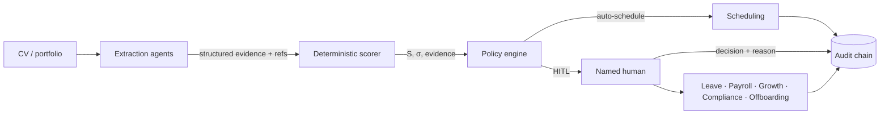
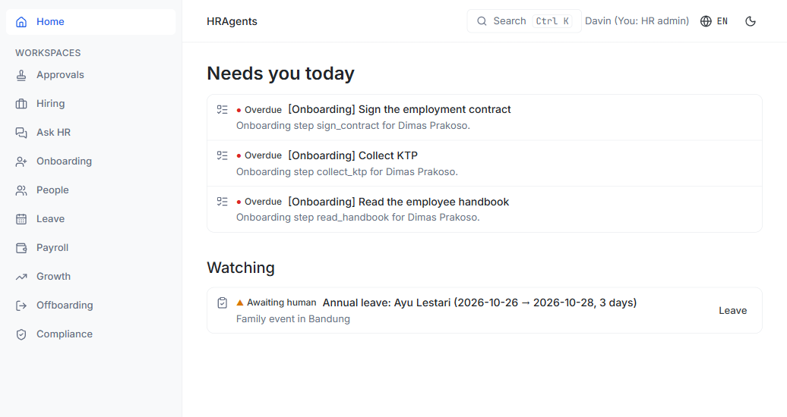
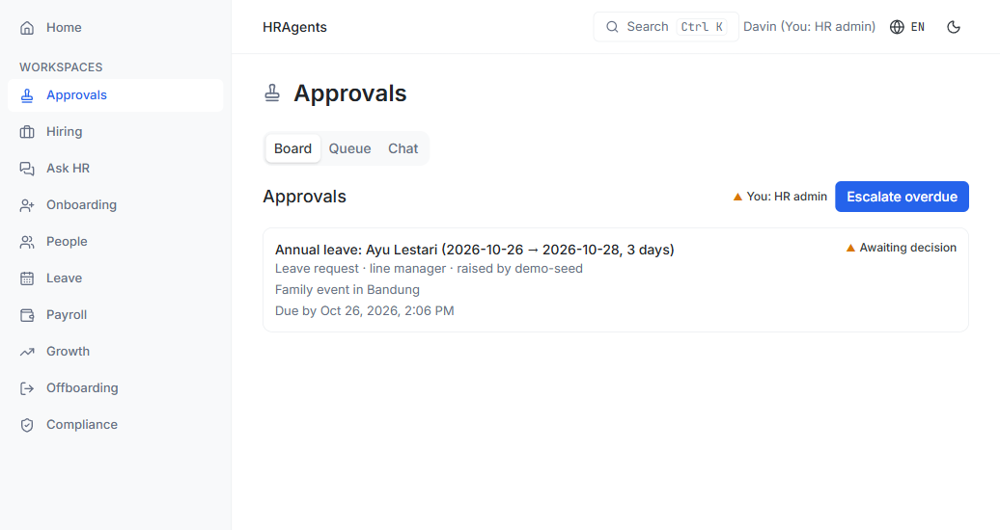
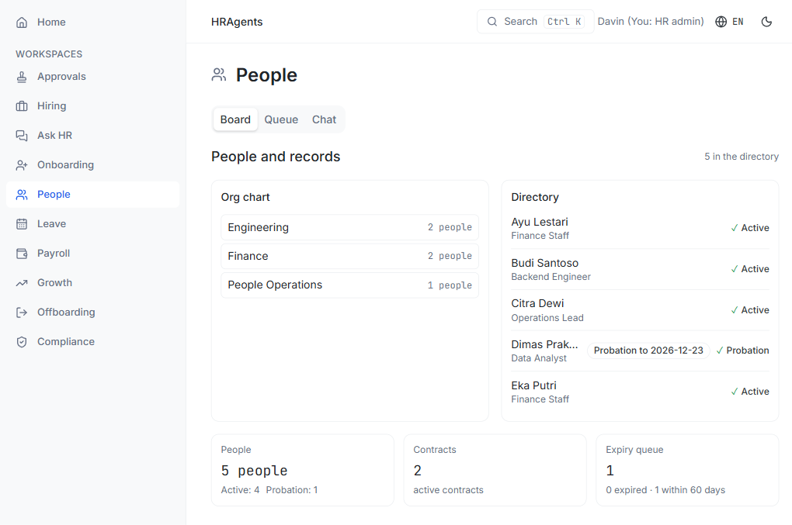
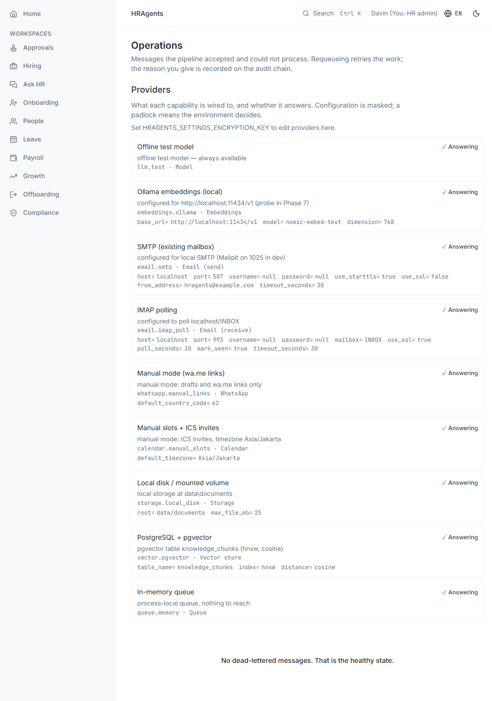

# HRAgents

A virtual HR team for the **HR department of one**.

HRAgents is a self-hosted platform for the whole employee lifecycle — hiring,
onboarding, records, leave, payroll **preparation**, compliance, growth and
offboarding. Language models extract and draft; deterministic code scores and
routes; a named human decides everything consequential. Every outcome is
reconstructible from a tamper-evident audit chain.

[Quickstart](quickstart.md){ .md-button .md-button--primary }
[Architecture](architecture/system-architecture.md){ .md-button }
[GitHub](https://github.com/davinakmalyasha/HRAgents){ .md-button }

## What it actually does

- **Evaluates candidates with a deterministic scorer.** LLM agents deconstruct a
  CV and portfolio into structured evidence; the score is pure Python over that
  evidence, with the references behind every dimension. The same input scores
  the same, every time.
- **Bounds automation in code.** Auto-scheduling requires a high score, low
  run-to-run variance, zero anomaly flags and evidence for every dimension.
  Rejections above the merit floor require a named human; below it, a documented
  rejection with a feedback report. Unevidenced scores are zeroed and can neither
  schedule nor reject automatically.
- **Runs the department, not just the ATS.** Onboarding plans, contracts and
  expiry reminders, leave balances and approval queues, payroll runs with
  operator-verified statutory tables (never hardcoded rates), growth cycles,
  compliance deadlines and data-subject requests, offboarding and asset
  clearance — in nine workspaces over one audit trail.
- **Keeps a real record.** Every state transition is an audit entry in a hash
  chain. Evaluations persist the exact rubric family and digest that produced
  them; payroll runs are immutable once reviewed and a re-run supersedes rather
  than overwrites.
- **Degrades honestly.** No cloud keys are required. The offline test model,
  hash embeddings, local documents and manual WhatsApp/calendar transports are
  the defaults; each provider reports whether it is configured and answering.

## What it deliberately does not do

| Not done | Why |
|---|---|
| Execute payments | Payroll is prepare, verify and export; bank files are a human step |
| Auto-reject above the merit floor | A rejection is a named human's decision with a reason |
| Run shell or arbitrary command tools | Agents read and extract; they do not operate the machine |
| Hardcode statutory rates | Operator-maintained, source-verified rate tables gate payroll math |
| Decide who gets hired | The system routes evidence and drafts; people decide |
| Scrape or infer protected attributes | Scoring consumes only the four documented dimensions |

## How the pieces fit

The full pipeline, the automation bounds, and the data model are documented
under [Architecture](architecture/system-architecture.md); the exact decision
table is in [Human-in-the-loop bounds](architecture/hitl-bounds.md).

## A look inside

The demo dataset, seeded through the real services:

## Status

`v0.15.0` — the core loop, ten workspaces, the PWA, payroll preparation,
compliance, observability and a self-host compose stack are in place and published.
Open work is tracked honestly in [Remaining work](plan/remaining-work.md).

Apache-2.0. Built and tested in Jakarta; Bahasa Indonesia and English in the
dashboard.
