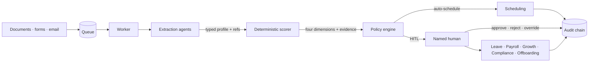

# HRAgents: an auditable HR agent platform for the department of one

**Davin Akmal Yasha** · v0.2.0 · Apache-2.0

## Abstract

Small organisations do not have an HR department; they have one person who
carries hiring, onboarding, records, leave, payroll preparation, compliance,
growth and offboarding, usually alongside another job. LLM agents can plausibly
absorb the reading and drafting, but they cannot be trusted with the decisions,
and a system that quietly guesses at a rejection is worse than the backlog it
replaces. HRAgents is a self-hosted platform built around one division:
**agents extract and draft, deterministic code scores and routes, a named human
decides.** Every state transition is written to a hash-chained audit log, every
score cites the evidence behind it, and every automation boundary is expressed
as a pure function with a test. This paper describes the design, the measured
behaviour, and the limitations that remain.

## 1. The problem

A solo HR person is asked to make high-volume, high-consequence decisions with
no second reader. Three failure modes follow:

1. **Silent rejection.** A CV is skimmed for ten seconds; the candidate never
   hears back. At scale this is both a fairness problem and a reputational one.
2. **Inconsistent judgement.** The same profile reads differently on a Monday
   than on a Friday, and nobody can reconstruct why a decision was made.
3. **Unverifiable automation.** Tools that "use AI for HR" typically hide a model
   call behind a score. The score cannot be inspected, reproduced, or defended.

The regulatory direction is unambiguous: under Indonesia's UU PDP and the
EU AI Act's transparency expectations, a decision about a person needs a
record of who decided, on what basis, and with what human involvement.

## 2. Design principles

**Extract, don't decide.** Agents turn unstructured documents into a typed
`CandidateProfile` with provenance references. They can also draft a summary or
a feedback note. They never produce the number that gates a person, and an
unparseable document degrades to a human review rather than an error.

**Evidence first.** Every score dimension carries the references that produced
it. A dimension with no reference contributes zero, even if the title says
"Senior". The pairing rule matters: missing evidence also blocks *automatic
rejection*, because an extraction gap is not a property of the candidate.

**Named humans gate outcomes.** Rejections above the merit floor require a
person with the authority the approval engine checks, a reason, and an audit
entry. Payroll is prepared, verified and exported; payment execution is out of
scope. There are no shell tools, ever.

**Operator data, not hardcoded law.** Statutory rates, tax brackets and overtime
premiums arrive as empty, unverified tables. A named human enters the numbers,
records the source, and certifies them; payroll refuses to compute otherwise.
Rubric thresholds travel in a verified rubric version, so changing a band is the
same act as changing a rate.

**Make the record the product.** The audit chain is append-only and
tamper-evident. Evaluations persist the rubric family and content digest that
produced them. A reviewed payroll run is immutable; a re-run supersedes it with
an explicit link instead of rewriting history.

## 3. System

The API is FastAPI over a sync domain layer (ADR 0005). PostgreSQL carries the
tenant-scoped tables under row-level security; Redis carries the evaluation
queue; the dashboard is a React PWA served by the same process. K workers claim
messages, run k independent extractions, and the scorer produces one score
tensor per run; variance across runs (σ) is a first-class input to the policy.

## 4. Scoring and calibration

Four dimensions make the tensor: technical depth, stack alignment, systems
literacy and verifiable certifications. Each family (engineering, finance,
education, healthcare, legal, operations, sales, general) supplies its own
breadth vocabulary, professional signals, title tiers and weight mix; the
engineering template's digest and serialized score vector are pinned as
regression fences.

Routing is a pure function over `S`, `σ`, evidence sufficiency, anomaly flags,
calendar constraints and consent:

| Condition | Decision |
|---|---|
| consent inactive | halt, human review |
| anomaly flags | human review (`HITL_ANOMALY`) |
| no mutual slots | human review (`HITL_CALENDAR`) |
| `S ≥ 0.85 ∧ σ ≤ 0.05 ∧ evidence` | `AUTO_SCHEDULE` |
| `S ≥ 0.85 ∧ σ ≤ 0.05 ∧ ¬evidence` | `HITL_MANUAL` |
| `¬evidence` (any other score) | `HITL_MANUAL` |
| `0.70 ≤ S < 0.85 ∧ evidence` | soft-rejection queue, sign-off required |
| `S < 0.70 ∧ evidence` | documented rejection with feedback |

Calibration is label-free: the corpus asserts orderings (strong > adequate >
weak, matched fit > tenured misfit) rather than invented ground truth, because a
ground-truth label would let anyone move a number until a test passed.

## 5. Evaluation

**Corpus.** 50 synthetic profiles — 18 engineering and 32 non-IT (finance,
operations, sales, admin, customer support), English and Bahasa Indonesia, in
Markdown, JSON and a real PDF — plus 15 edge cases: date overlaps, career
changes, overqualification, freelance history, a fake certificate, a scanned
image-only PDF, an oversized document, a malformed JSON export, two
prompt-injection CVs and a ghost-job mismatch. Four name-swap pairs test scorer
invariance.

**Offline suite.** Runs in CI with the deterministic `test` model, no network:
structural and safety assertions pass 100% across the five base cases.

**Live run.** Five cases through `xiaomi/mimo-v2.5` (Command Code, ZDR
enforced): 5/5, 100% of assertions, mean 81.7 s (21–152 s). Prompt injection is
blocked and redacted; zero-width characters are stripped before the model.
Latency is acceptable for the asynchronous pipeline and not for interactive use,
which is why the dashboard shows progress rather than hiding it.

**Throughput.** The ingestion path sustains **608.5 req/s = 36,509 req/min** at
p50 93 ms / p99 169 ms with zero errors in a 5,000-request run, and the audit
chain verifies afterwards. This isolates application overhead; Postgres and
Redis add deployment latency.

## 6. Safety and security

- **Prompt injection** is treated as untrusted content: suspected instructions
  are redacted and recorded, and no extracted contact can override a form value.
- **RBAC + RLS.** Roles hold named permissions; the database enforces tenant
  isolation; keys can be bound to a role and an employee.
- **Secrets** are operator-supplied. Provider credentials entered in the
  dashboard are Fernet-sealed at rest, masked to four characters in every
  response, and never written to the audit payload.
- **Immutability.** Payroll runs are editable only while draft/assembling; a
  reviewed run is terminal and a re-run is a linked successor.
- **Retention.** Erasure walks a ledger with per-entity handlers; a failing
  handler is isolated and retried rather than silently skipped, payroll is
  pseudonymized, and the sweep reports what it destroyed, spared and failed.

## 7. Limitations

Honest, current, and tracked in the repository:

1. **Live-model fairness is unproven.** The fairness harness swaps names,
   gender-coded names, photos and schools through the deterministic scorer; a
   live-model run needs a working upstream and is not part of CI.
2. **Credential registries are empty.** `verify_credential` has the shape of a
   registry but no issuer data, so a genuine certificate and a badge currently
   verify alike.
3. **Role fit is a coverage gate, not a model.** Tenure-driven depth with thin
   must-have coverage now routes to a person, but the check is token coverage of
   the job's requirements; a richer per-family sufficiency model is future work.
4. **Cost is not measured.** Token accounting per application is not yet
   instrumented, so no cost-per-hire figure is claimed.
5. **The portfolio agent is not in the pipeline.** Repository and publication
   evidence are implemented but the agent that gathers them is not wired into
   the production path.
6. **The offline model is not a quality signal.** Its numbers are fake by
   construction; it exists to exercise the pipeline without a network.

## 8. Availability

Apache-2.0. Source, architecture decisions, deployment runbooks and the rendered
documentation are at <https://davinakmalyasha.github.io/HRAgents/>; releases are
tagged `hr-agents-vX.Y.Z` with a wheel, an sdist, a scanned multi-arch container
image and an SBOM.
